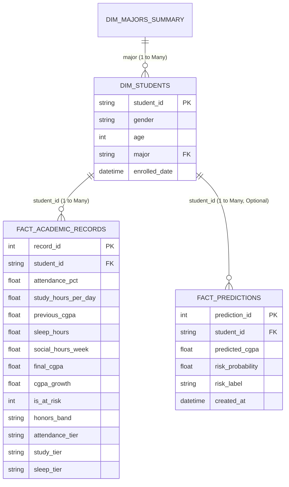

# EduPredict AI — Power BI Dashboard Blueprint & DAX Guide

This guide provides a complete, step-by-step blueprint for building an institutional-grade Power BI Analytics Dashboard for **EduPredict AI**.

---

## 1. Quick Data Ingestion Options

You have two convenient ways to load data into Power BI Desktop:

### Option A: Direct CSV Import (Recommended — Zero Server Overhead)
Run the automated export script in your terminal:
```powershell
python -m src.export_powerbi_data
```
This generates four clean, pre-modeled CSV datasets in `data/powerbi/`:
1. `dim_students.csv` (Demographics: ID, Gender, Age, Major)
2. `fact_academic_records.csv` (Performance metrics: Attendance, Study hours, CGPAs, Sleep, Social hours, Honors bands)
3. `dim_majors_summary.csv` (Pre-aggregated departmental benchmarks)
4. `fact_predictions.csv` (Model inference log & risk probabilities)

In Power BI Desktop:
- Click **Get Data → Text/CSV** and import all 4 files.

### Option B: Direct PostgreSQL Connection
If running via Docker Compose or a local PostgreSQL instance:
- Click **Get Data → PostgreSQL database**.
- Server: `localhost:5432`, Database: `edupredict`.
- Select views:
  - `v_powerbi_student_dim`
  - `v_powerbi_academic_facts`
  - `v_powerbi_major_aggregates`
  - `v_powerbi_risk_summary`
  - `v_powerbi_prediction_history`

---

## 2. Data Model & Star Schema Architecture

Establish the following relationships in the **Model View**:



*Relationship Settings:*
- `Dim_Students[student_id]` to `Fact_Academic_Records[student_id]`: **1 to Many (1:\*)**, Single cross-filter direction.

---

## 3. DAX Measures Library (Ready to Copy-Paste)

Create a dedicated measure table called `_KeyMeasures` in Power BI:

### A. Core Academic KPIs
```dax
Total Students = COUNTROWS('dim_students')
```
```dax
Avg Final CGPA = AVERAGE('fact_academic_records'[final_cgpa])
```
```dax
Avg Previous CGPA = AVERAGE('fact_academic_records'[previous_cgpa])
```
```dax
Avg Attendance Pct = AVERAGE('fact_academic_records'[attendance_pct]) / 100
// Note: Format as Percentage (0.0%)
```
```dax
Avg Daily Study Hours = AVERAGE('fact_academic_records'[study_hours_per_day])
```
```dax
Avg Nightly Sleep Hours = AVERAGE('fact_academic_records'[sleep_hours])
```
```dax
Avg Weekly Social Hours = AVERAGE('fact_academic_records'[social_hours_week])
```

### B. Risk & Honors Indicators
```dax
At-Risk Students Count =
CALCULATE(
    COUNTROWS('fact_academic_records'),
    'fact_academic_records'[final_cgpa] < 2.0
)
```
```dax
At-Risk Rate =
DIVIDE(
    [At-Risk Students Count],
    [Total Students],
    0
)
// Note: Format as Percentage (0.00%)
```
```dax
First Class Honors Count =
CALCULATE(
    COUNTROWS('fact_academic_records'),
    'fact_academic_records'[final_cgpa] >= 3.5
)
```
```dax
First Class Rate =
DIVIDE(
    [First Class Honors Count],
    [Total Students],
    0
)
```
```dax
CGPA Growth Delta =
[Avg Final CGPA] - [Avg Previous CGPA]
```

### C. Conditional Formatting & Alert Colors
```dax
Risk Status Color =
SWITCH(
    TRUE(),
    [At-Risk Rate] > 0.05, "#DC2626", // Red alert if > 5%
    [At-Risk Rate] > 0.02, "#F59E0B", // Amber warning if > 2%
    "#10B981"                          // Green normal
)
```

---

## 4. Page-by-Page Visual Layout Blueprint

### Page 1: Institutional Academic Overview (Executive Summary)
- **Top Row (KPI Cards):**
  1. `[Total Students]` (5,000)
  2. `[Avg Final CGPA]` (3.27)
  3. `[Avg Attendance Pct]` (83.8%)
  4. `[At-Risk Rate]` (0.84% / 42 Students)
- **Visual 1 (Clustered Column Chart):**
  - X-axis: `dim_students[major]`
  - Y-axis: `[Avg Final CGPA]` and `[Avg Previous CGPA]`
  - Title: *Average CGPA by Academic Major (Prior vs Final Outcome)*
- **Visual 2 (Donut Chart):**
  - Legend: `fact_academic_records[honors_band]`
  - Values: `[Total Students]`
  - Title: *Academic Degree Honors Distribution*
- **Visual 3 (Slicers):**
  - Major dropdown
  - Gender radio buttons

---

### Page 2: Performance Drivers & Behavioral Correlations
- **Visual 1 (Scatter Plot):**
  - X-axis: `fact_academic_records[attendance_pct]`
  - Y-axis: `fact_academic_records[final_cgpa]`
  - Legend: `dim_students[major]`
  - Add: Trend line (demonstrating positive slope)
  - Title: *Empirical Attendance vs Final CGPA Correlation*
- **Visual 2 (Clustered Bar Chart):**
  - Y-axis: `fact_academic_records[study_tier]` (<2 hrs, 2-4 hrs, 4-6 hrs, 6+ hrs)
  - X-axis: `[Avg Final CGPA]`
  - Title: *Impact of Daily Study Time on Student CGPA*
- **Visual 3 (Matrix Table):**
  - Rows: `dim_students[major]`
  - Columns: `fact_academic_records[attendance_tier]`
  - Values: `[Avg Final CGPA]`
  - Data Bars: Apply green conditional data bars.

---

### Page 3: Student Well-being & Balance (Sleep vs Social Habits)
- **Visual 1 (Line Chart with Markers):**
  - X-axis: `fact_academic_records[sleep_hours]` (grouped)
  - Y-axis: `[Avg Final CGPA]`
  - Title: *The Sleep Curve: Optimal Academic Performance Peak (7-8 Hours)*
- **Visual 2 (Clustered Column Chart):**
  - X-axis: `fact_academic_records[social_hours_week]` (binned 0-5, 6-10, 11-15, 16+)
  - Y-axis: `[Avg Final CGPA]`
  - Secondary Y-axis: `[At-Risk Rate]`
  - Title: *Social Commitment Tiers vs Grade Outcomes*
- **Visual 4 (Decomposition Tree):**
  - Analyze: `[Avg Final CGPA]`
  - Explain By: `major` → `attendance_tier` → `study_tier` → `sleep_tier`

---

### Page 4: Early Warning Watchlist & Model Auditing
- **Visual 1 (Intervention Table):**
  - Columns: `student_id`, `major`, `gender`, `previous_cgpa`, `attendance_pct`, `study_hours_per_day`, `final_cgpa`
  - Visual Filter: `fact_academic_records[is_at_risk] = 1` OR (`previous_cgpa < 2.5` AND `attendance_pct < 75`)
  - Title: *High Priority Academic Intervention List*
- **Visual 2 (Gauge Chart):**
  - Value: `[At-Risk Rate]`
  - Target: `0.01` (1.00%)
  - Maximum: `0.05` (5.00%)
  - Title: *Cohort Risk Rate vs Departmental Target*
- **Visual 3 (Model Inferences Summary Table from `fact_predictions`):**
  - Columns: `prediction_id`, `major`, `predicted_cgpa`, `risk_probability`, `risk_label`, `created_at`
  - Title: *Live Audit Log of Inference Service*

---

## 5. Recommended Color Theme & Formatting

| Element | Recommended Color | Hex Code |
|---|---|---|
| Primary Header / Navy | Deep Navy | `#123B57` |
| Primary Accent / Teal | Academic Teal | `#087E78` |
| Low Risk / First Class | Emerald Green | `#10B981` |
| Moderate Warning | Amber Gold | `#F59E0B` |
| High Risk Alert | Crimson Red | `#DC2626` |
| Background Neutral | Off-white Wash | `#F8FAFC` |

*Font Family:* **Segoe UI** or **Aptos** across all titles, callout numbers, and axis labels for a crisp, native Power BI aesthetic.
